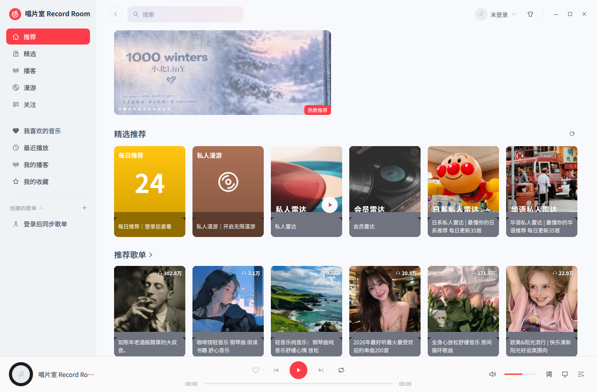
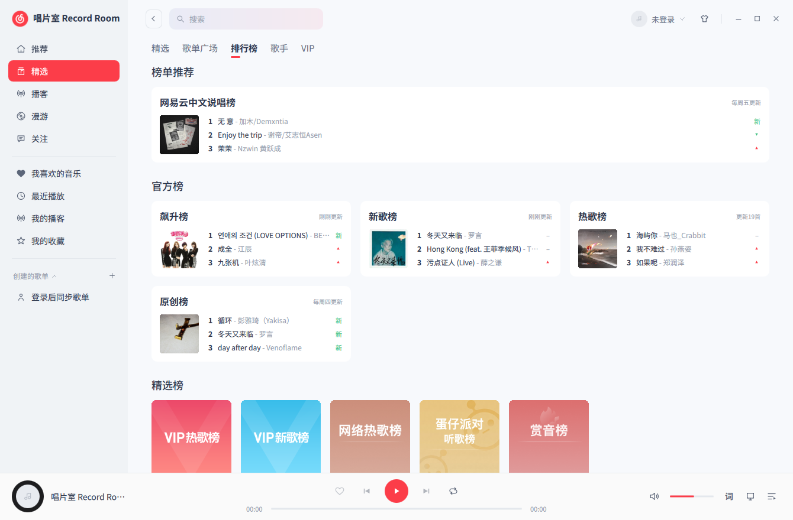
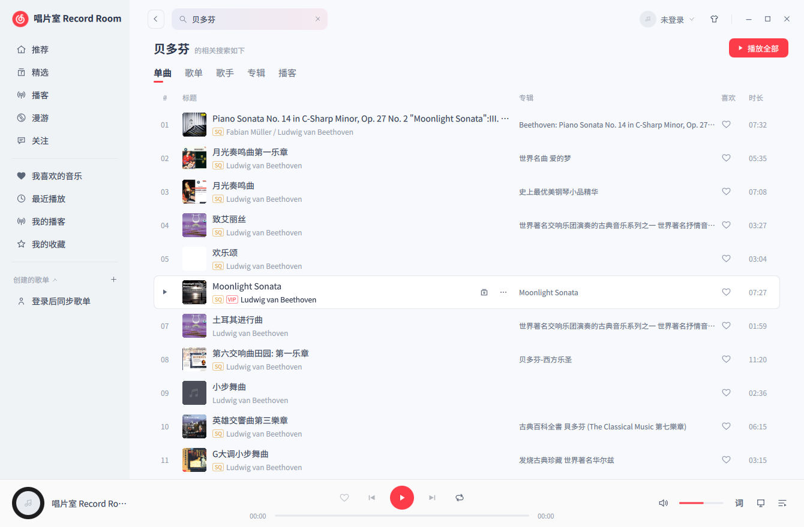
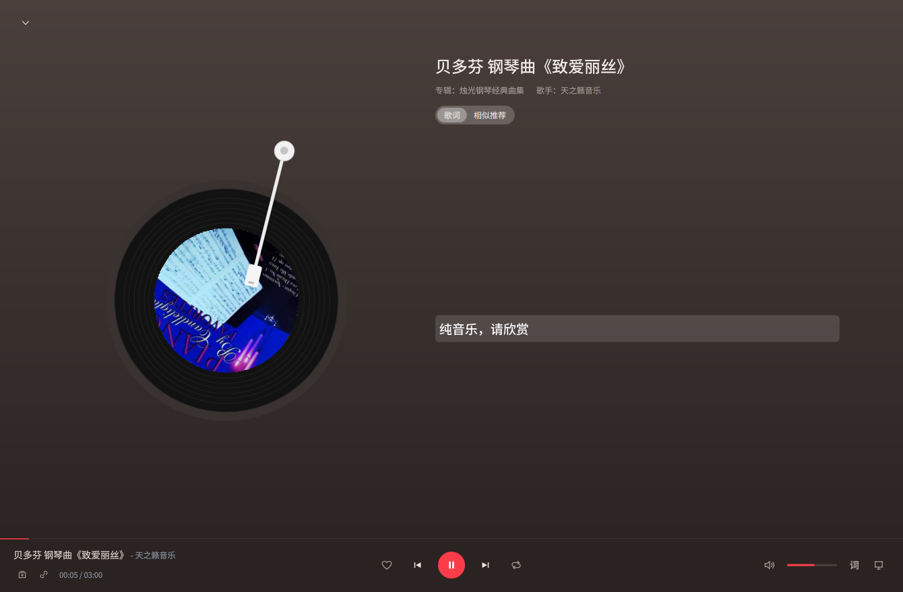

# 唱片室 Record Room

Record Room 是一款用 C++ 和 Qt Quick/QML 编写的 Linux 桌面音乐客户端。打开应用就能浏览网易云音乐的公开榜单、搜索歌曲并播放；扫码登录后，还可以同步歌单、收藏音乐和使用私人漫游。



## 安装

在 Ubuntu 24.04（x86-64）上，从[发行页](https://github.com/c99z/record-room/releases/latest)下载 `.deb` 安装包。在下载目录执行：

```bash
sudo apt install ./record-room_0.1.0_amd64.deb
```

安装后，在应用菜单打开「唱片室 Record Room」，或在终端运行 `record-room`。

## 主要功能

- **发现音乐**　从推荐页进入雷达歌单，按分类逛歌单广场，或在排行榜查看热门曲目和排名变化。播客区可以按分类找节目，也能浏览热门榜和新晋榜。
- **分类搜索**　按单曲、歌单、歌手、专辑或播客查看结果。点击曲目即可播放，也可以从列表进入歌手或专辑详情。
- **播放与歌词**　全屏播放页提供黑胶唱片视图、歌词和相似推荐。队列支持下一首播放、移除曲目，以及顺序、随机、单曲循环和列表循环四种模式。
- **个人音乐库**　扫码登录后可以查看最近播放、创建歌单、收藏歌单，或用播放栏的红心把歌曲加入「我喜欢的音乐」。
- **桌面集成**　支持浅色和深色主题、独立桌面歌词窗口，以及通过 MPRIS 使用系统媒体控件和键盘媒体键。

## 界面截图

| 排行榜 · 对照不同榜单的热门曲目 | 分类搜索 · 查看单曲、歌手与专辑 |
| --- | --- |
| [](docs/screenshots/charts.png) | [](docs/screenshots/search.png) |

播放《致爱丽丝》时，左侧黑胶唱片展示专辑封面，右侧歌词区显示「纯音乐，请欣赏」。



### 桌面歌词

播放时点击底栏的「词」，歌词会在独立悬浮窗中随音乐高亮。右键点击「词」可以切换样式；锁定窗口后，再点一次即可解锁。以下是播放《茉莉花》时的三个窗口实拍。

**黑胶胶囊**将封面、当前歌词和进度收在一条窄栏里。


**舞台双轨**在左右两侧交替显示歌词，可以提前看到下一句。


**唱片铭牌**在歌词旁保留方形封面、曲目名和播放时间。


## 构建与运行

需要 C++17 编译器、CMake 3.21+、Ninja、OpenSSL 开发库，以及 Qt 6.9+ 的 Quick、Quick Controls 2、Qml、Network、Multimedia 和 DBus 模块。在仓库根目录运行：

```bash
qt-cmake -S qt-client -B qt-client/build -G Ninja -DCMAKE_BUILD_TYPE=Release
cmake --build qt-client/build
./qt-client/build/record-room
```

客户端直接连接网易云音乐服务。更多运行选项见[客户端说明](qt-client/README.md)，各页面的支持情况见[功能核对](qt-client/功能核对.md)。
